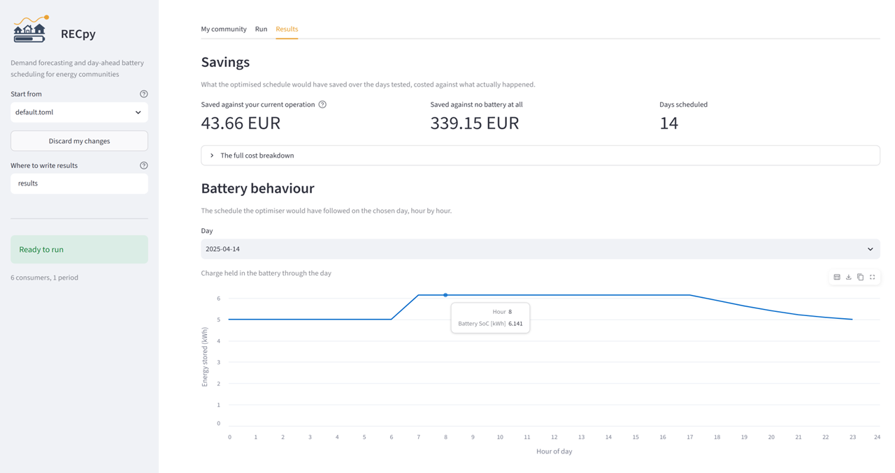

# RECpy

[](https://github.com/jmolleda/RECpy/actions/workflows/tests.yml)
[](https://www.python.org/downloads/release/python-3120/)
[](LICENSE)
[](https://doi.org/10.5281/zenodo.21129972)
[](https://www.repostatus.org/#active)
[](https://jmolleda.github.io/RECpy/)

RECpy forecasts the next-day electricity demand of each consumer in an energy
community and schedules a shared battery against day-ahead prices. Every metered
consumer gets its own forecasting model, selected on its own data.
RECpy simulates rather than controls: a community can see what a shared
battery would have saved before deploying anything.



This repository contains the source code accompanying the paper:

> F. Cosío, J. Molleda, F. Díez, R. Usamentiaga.
> *A particularized forecasting and optimization framework for rural energy communities.*
> Machine Learning with Applications, vol. 26, art. 101016, December 2026.
> <https://doi.org/10.1016/j.mlwa.2026.101016>

Please cite that article if you use this software. The exact release that produced
its results is archived at <https://doi.org/10.5281/zenodo.21129973>.

This release, v2.0.0, is archived at <https://doi.org/10.5281/zenodo.23208125>, and
<https://doi.org/10.5281/zenodo.21129972> always resolves to the most recent release.

It provides the full forecasting, statistical model-selection, and day-ahead
optimization pipeline evaluated on an operational rural energy community (EC) of
six supply points. The supply points are identified as **SP1–SP6** throughout: they
are anonymized to protect the privacy of the participating households, not as an
artifact of peer review.

## Repository layout

```
app/     local web front end (Streamlit) and the application icon
code/    all analysis scripts (+ run_pipeline.py, check_data.py)
config/  experiment configurations (default.toml, quick.toml)
data/    a fully synthetic example dataset (see below)
docs/    the documentation site (MkDocs)
tests/   the test suite (pytest)
requirements.txt      core pipeline
requirements-gui.txt  front end (adds Streamlit)
requirements-docs.txt documentation site
CITATION.cff, codemeta.json   how to cite this software
LICENSE  (MIT)
```

Running the scripts creates their own output folders under `code/`
(`cross_validation/`, `cross_validation/figures/`, `optimization_results/`),
so no manual setup is required.

## Setup

Python 3.12 with the pinned dependencies:

```bash
pip install -r requirements.txt
```

## Configuration

Nothing is hard-coded in the scripts: every setting — calendar year, data files,
cross-validation folds, supply points, model hyperparameters, battery and grid
limits — lives in a TOML file read by `code/recpy_config.py`.

```bash
python code/recpy_config.py                       # print the active configuration
RECPY_CONFIG=config/quick.toml python code/...    # use a different configuration
RECPY_OUTPUT_DIR=/results python code/...         # redirect outputs only
```

Two configurations are shipped:

| File | Purpose |
| --- | --- |
| `config/default.toml` | The published experiment: 6 supply points, 4 seasonal folds, 15 regressors, ARIMA/SARIMAX and LSTM/GRU/TCN. Reproduces the results in the article. |
| `config/quick.toml` | A reduced run of the same pipeline that finishes in minutes: 2 supply points, 1 fold, the first days of the test month, 5 regressors. For smoke-testing and for hosted platforms with a limited compute budget. |

`config/default.toml` reproduces the archived v1.0.0 behaviour exactly, so an
unmodified checkout needs no configuration at all. To run the framework on a
different energy community, copy it and edit the `[[supply_points]]`,
`[[folds]]`, `[battery]` and `[grid]` sections; `RECPY_OUTPUT_DIR` keeps the
results of each configuration apart.

`config/quick.toml` reduces the *scale*, not the method: every model keeps its
published hyperparameters and every stage of the pipeline runs, in about four to
five minutes on one core. It is a smoke test, not a result — five test days are
too few for the Wilcoxon tournament to be conclusive and two supply points too
few for the community-level savings to mean anything, so the numbers it prints
should not be read as the published ones.

## Data availability

The **raw household consumption series are not included** for privacy reasons. They
may be requested from the corresponding author, J. Molleda
(<jmolleda@uniovi.es>), and will be shared where the privacy constraints of the
participating households allow.

So that the pipeline can nonetheless be **run end-to-end**, the `data/` folder
ships a **fully synthetic** example dataset produced by
[`code/make_synthetic_data.py`](code/make_synthetic_data.py) (seeded and
reproducible). It contains **no real consumption** — every series is drawn from
simple seasonal models plus noise — and follows the same schema and file names
the scripts expect. Regenerate it at any time with:

```bash
python code/make_synthetic_data.py
```

Expected files and columns (real or synthetic):

| File | Columns |
|------|---------|
| `data/consumption_SP1.csv` … `consumption_SP6.csv` | `date_time`, `C_SPk` |
| `data/consumption_meteo_calendar.csv` | `date_time`, `C_SP1`…`C_SP6`, `Hour`, `DoW`, `Month`, `Weekend`, `Holidays`, weather features |
| `data/prices_cv_folds.csv` | `datetime`, `PVPC`, `Compensation` |
| `data/solar_generation.csv` | `datetime`, `PV to inverter A`, `PV to inverter B`, `Battery Power` |

Prices are taken from the Spanish TSO ESIOS service and weather features from the
Open-Meteo API; the corresponding synthetic columns imitate their format.

## Using your own data

Nothing about this community is hard-coded. A different one needs a
configuration naming its files and the columns inside them:

```toml
[paths]
data = "/path/to/my/csv/files"

[columns]
timestamp_consumption = "Timestamp"      # in the consumption and weather files
timestamp_market = "Timestamp"           # in the price and generation files
import_price = "buy_eur_kwh"
export_price = "sell_eur_kwh"
generation = ["roof_array_kw", "barn_array_kw"]
battery_power = "battery_kw"
```

Then check the data before running anything:

```bash
RECPY_CONFIG=config/mine.toml python code/check_data.py
```

It reports, per file, whether the timestamp column is there and parses, whether
the series is hourly and gap-free, whether it covers whole days and the periods
you configured, whether the named columns exist, and whether the values are
plausible — in terms of your files, rather than as an error from inside a
forecasting script. The front end runs the same checks from its **Check my
data** button.

The framework expects **hourly** data in whole days. Sub-hourly series need
resampling first; supporting them directly is planned, not present.

## Running the experiment

The whole forecasting-to-scheduling pipeline runs with one command, which
executes the stages in dependency order and reports the time each one took:

```bash
python code/run_pipeline.py                                        # published configuration
RECPY_CONFIG=config/quick.toml python code/run_pipeline.py         # minutes, reduced scale
```

If the configured data files are absent, the synthetic dataset is generated
first. The configuration is checked before anything expensive starts, so an
inconsistency — a model family nobody runs, a supply point whose selected model
was left out of the regressor subset — is reported immediately rather than hours
in.

The six stages the driver runs can also be run on their own, in this order:

```bash
# 1. Forecasting -- build the per-fold prediction files
python code/generate_ml_cv.py          # ML regressors + Naive-168
python code/generate_arima_cv.py       # ARIMA / SARIMAX (adds columns)
python code/generate_dl_cv.py          # LSTM / GRU / TCN, single-fit (adds columns)

# 2. Statistical model selection
python code/wilcoxon_cv.py             # Wilcoxon net-wins tournament

# 3. Visualization
python code/visualize_cv.py            # plots -> <output>/cross_validation/figures/

# 4. Optimization
python code/run_optimization_cv.py     # day-ahead LP over the folds
```

The remaining scripts are the additional experiments reported in the article.
They are not part of the driver because they are sensitivity and robustness
analyses rather than the pipeline itself:

```bash
python code/generate_dl_cv_daily.py                # LSTM/GRU/TCN, daily-retrained
python code/wilcoxon_cv_robust.py                  # daily agg., Holm/BH, Diebold-Mariano
python code/optimization_degradation.py            # battery-degradation sensitivity
python code/optimization_lookahead_downstream.py   # PV look-ahead + downstream cost
python code/ensemble_analysis.py                   # forecast-combination strategies
python code/cold_start_analysis.py                 # limited-history (cold-start) experiment
python code/timing_analysis.py                     # training / retraining times
```

## Web front end

For setting up a community without editing TOML by hand:

```bash
pip install -r requirements-gui.txt
streamlit run app/recpy_app.py
```

Then open <http://127.0.0.1:8501>. The interface has three tabs: **Configuration** (edit
supply points, folds, battery and grid limits, the model families and the
regressor subset, with the consistency check live in the sidebar, and save the
result as a new TOML), **Run** (a time estimate from measured per-fit times, then
the pipeline as a subprocess with its log streaming in), and **Results** (the
model-selection ranking, observed-against-forecast charts with per-model MAE and
RMSE, the scheduling summary and savings, and the visualizations).

**It runs only on this machine.** `.streamlit/config.toml` binds the server to
`127.0.0.1`, because the series it reads are household consumption data and
Streamlit otherwise listens on every interface and advertises an external URL.
Nothing is uploaded and no telemetry is sent.

The interface adds no analysis of its own: it edits a configuration, writes it
out, and runs `code/run_pipeline.py` against it. A chart obtained through the
interface is the chart the scripts produce, and the configuration it saves runs
identically from the command line.

## Reproducibility

- **Python** 3.12; dependencies pinned in `requirements.txt`.
- **Random seed** `random_seed = 123` (with `PYTHONHASHSEED=0`, and
  NumPy/TensorFlow seeded) is set in the configuration file.
- **Calendar year**: fold boundaries are specified as month–day only and combined
  with the `year` key of the active configuration (placeholder `2025`); the
  synthetic dataset uses the same value. Set `year` in your configuration file to
  the calendar year of your data before running on real data.
- **Equivalence with the archived release**: `code/test_config_equivalence.py`
  checks that `config/default.toml` resolves to the 108 values that the archived
  v1.0.0 release — the version that produced the published results — held as
  literals in its scripts: fold boundaries and labels, supply points, deployed
  models, deep-learning hyperparameters and feature exclusions, ARIMA/SARIMAX
  orders and exogenous variables, battery and grid limits, seed and lookback.
  Run it after changing anything in `config/default.toml`.
- **Bit-for-bit reruns**: every model is exactly reproducible except Random Forest
  and Extra Trees, which are fitted with `n_jobs=-1` and so average their trees in
  whatever order the threads finish. Their predictions move by about one machine
  epsilon (~1e-16) between runs of identical code; `n_jobs=1` removes the variation
  at a large cost in time. Re-running therefore reproduces 20 of the 22 prediction
  columns byte for byte and those two to ~1e-15 relative. No reported figure, model
  ranking or saving depends on the difference — the Wilcoxon outputs computed from
  these columns are themselves byte-identical across runs.
- **Evaluation protocol**: blocked expanding-window cross-validation with four
  seasonal folds (April, July, October, December) and walk-forward 24-hour
  forecasting. ML/statistical models are univariate (192-hour consumption lag);
  deep-learning models are multivariate (calendar + weather features).

## Tests

```bash
pip install pytest tomli-w
python -m pytest                 # the whole suite, about 20 seconds
python -m pytest -m "not slow"   # skip the two end-to-end runs
```

The suite covers what the configuration layer resolves and what it refuses, the
data checker against a dataset damaged one fault at a time, and two end-to-end
runs: a one-consumer, one-day, one-model pipeline, and the same on a dataset
whose columns are named as another community's would be. It runs on every push
through GitHub Actions, which also installs the pinned requirements, so a
failure there means the declared environment no longer installs.

## Code layout (`code/`)

**Forecasting**
- `generate_ml_cv.py` — 15 ML/linear regressors, expanding-window walk-forward.
- `generate_arima_cv.py` — ARIMA / SARIMAX folds.
- `generate_dl_cv.py`, `generate_dl_cv_daily.py` — LSTM/GRU/TCN (single-fit and
  daily-retrained regimes); per-supply-point architectures come from the `[dl.*]`
  sections of the configuration.

**Statistical model selection**
- `wilcoxon_cv.py` — pairwise Wilcoxon signed-rank tournament (net wins).
- `wilcoxon_cv_robust.py` — robustness: daily-aggregated errors, Holm and
  Benjamini–Hochberg correction, and Diebold–Mariano (HAC + HLN) tests.

**Optimization**
- `opt_core.py` — shared LP core (Pyomo + HiGHS): parameterized battery
  degradation model, baselines, and a realized-cost evaluator.
- `run_optimization_cv.py` — day-ahead LP over the CV folds.
- `optimization_degradation.py` — degradation-model / cost sensitivity sweep.
- `optimization_lookahead_downstream.py` — PV look-ahead (perfect vs realistic)
  and Wilcoxon-vs-RMSE downstream-cost comparison.

**Additional analyses**
- `ensemble_analysis.py` — forecast combination (top-k average, NNLS stacking).
- `cold_start_analysis.py` — limited-history (2/4/8-week) onboarding experiment.
- `timing_analysis.py` — training / retraining time measurement.

**Visualization**
- `visualize_cv.py` — generates the result plots.

**Data**
- `check_data.py` — checks a dataset is the shape the pipeline expects, before
  anything runs. Importable, so the front end can use it too.
- `make_synthetic_data.py` — generates the synthetic example dataset in `data/`.

**Front end**
- `app/recpy_app.py` — the Streamlit interface described above. Optional; the
  pipeline does not import it.

**Infrastructure**
- `recpy_config.py` — loads the active configuration; every other script imports
  its settings from here. Run it directly to print the configuration in use.
- `run_pipeline.py` — runs the pipeline stages in dependency order, skipping the
  model families the active configuration excludes.

## License

Released under the **MIT License**; see `LICENSE`.

Version 1.0.0 — the release archived at
[10.5281/zenodo.21129973](https://doi.org/10.5281/zenodo.21129973), which produced the
results published in *Machine Learning with Applications* — was released under CC BY 4.0.
From this version onward the software is MIT-licensed.
