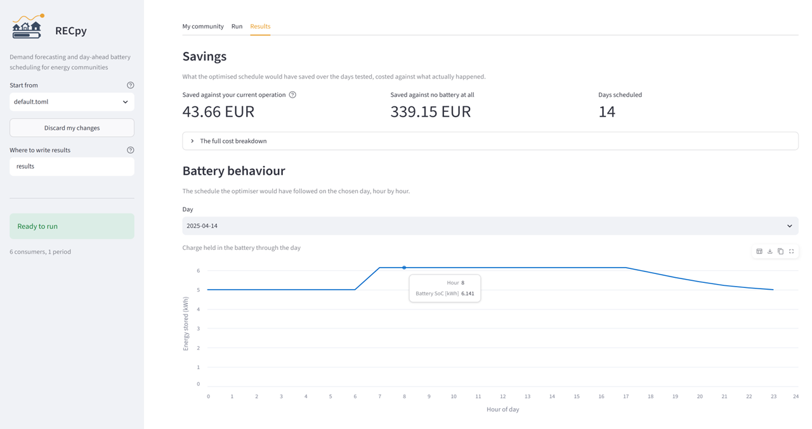

# RECpy

Particularized demand forecasting and day-ahead battery scheduling for energy
communities.

An energy community lets neighbours share generation and storage that none of
them could justify alone. Deciding what the shared battery should do tomorrow
means knowing what each member will consume tomorrow — and that is where the
usual approach strains. Aggregate demand is smooth and forecastable; a single
rural household is not. Its consumption is dominated by a handful of
individually visible appliances, so the sum of accurate community-level
forecasts can hide errors large enough to misdirect the battery for a whole day.

RECpy takes the opposite approach. **Every metered consumer gets its own
forecasting model, chosen on its own data**, by comparing candidates with a
statistical test rather than by picking the lowest error. The winner's forecasts
then drive a linear programme that schedules the shared battery against hourly
prices, and the result is costed against what actually happened.

*The optional local interface, after a run on the synthetic dataset that ships with the repository — not the published results.*

## What it does

- **Forecasts each consumer separately**

    Fifteen machine-learning regressors, ARIMA and SARIMAX, and three
    neural-network architectures, all trained per consumer and compared on the
    same footing.

- **Chooses by significance, not by decimal places**

    A pairwise Wilcoxon signed-rank tournament with multiple-comparison control,
    so a model that wins by a hair on one month is not promoted.

- **Schedules the shared battery**

    A day-ahead linear programme in Pyomo, solved with HiGHS, respecting
    capacity, power, state-of-charge and export limits, with battery wear priced
    in.

- **Reports honestly**

    Costs are evaluated on realised consumption, never on the forecasts that
    produced the schedule, so no look-ahead enters the saving.

## Where to start

| If you want to | Read |
| --- | --- |
| Try it on the example data | [Getting started](getting-started.md) |
| Point it at your own community | [Your own community](your-own-community.md) |
| Know what every setting does | [Configuration reference](configuration.md) |
| Understand the method | [What the pipeline does](pipeline.md) |
| Interpret the output | [Reading the results](results.md) |

## It runs on your machine

The consumption series RECpy reads are personal data: hourly household
consumption reveals occupancy and daily routine. Everything runs locally, and
the optional web interface binds to the loopback address rather than offering a
hosted service. Nothing is uploaded.

## Citing

If you use this software, please cite the article it implements:

> F. Cosío, J. Molleda, F. Díez, R. Usamentiaga, *A particularized forecasting
> and optimization framework for rural energy communities*, Machine Learning
> with Applications **26** (2026) 101016.
> <https://doi.org/10.1016/j.mlwa.2026.101016>

The software itself is archived on Zenodo, and
[`CITATION.cff`](https://github.com/jmolleda/RECpy/blob/main/CITATION.cff) in the
repository gives the machine-readable form.
