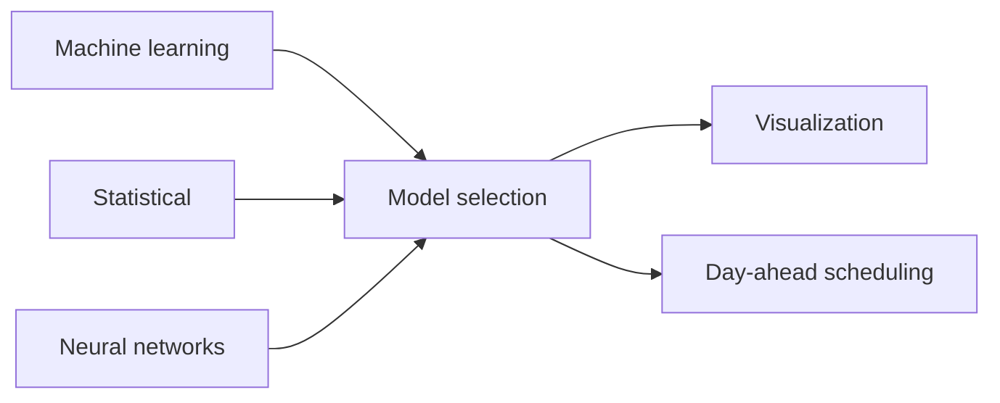

# What the pipeline does

Six stages, run in dependency order by `code/run_pipeline.py`. Each is an
ordinary script and can be run on its own.

The first three stages all write into the **same** prediction file per consumer
and period: the machine-learning stage creates it, the other two add their
columns. That is why the order matters, and why a run leaves one auditable
artifact per consumer and period with the observations and every forecast side
by side.

---

## 1. Machine-learning forecasts

`generate_ml_cv.py` — fifteen regressors, from linear and robust-linear through
trees, ensembles and gradient boosting, plus a seasonal-naive baseline
(`Naive-168`: the same hour one week earlier).

Forecasting is **walk-forward**: for each day of the test window the model is
re-fitted on everything observed so far, then asked for the next 24 hours
recursively, feeding its own predictions back as inputs. Models are univariate,
reading a `lookback_hours` window of the consumer's own consumption.

## 2. Statistical forecasts

`generate_arima_cv.py` — ARIMA and SARIMAX with per-consumer orders, and
exogenous weather or calendar variables for SARIMAX. SARIMAX is fitted once per
period and updated daily without refitting.

## 3. Neural-network forecasts

`generate_dl_cv.py` — LSTM, GRU and a temporal convolutional network, per
consumer, with architectures from the search reported in the article. Unlike the
first two stages these are **multivariate**: they read calendar and weather
features alongside consumption.

!!! note "Why the deep models are not the default choice"
    They are included so the comparison is fair, not because they win. On this
    kind of data they do not, and the article reports a feature-matched ablation
    showing their disadvantage is not merely a question of being under-fed.

## 4. Model selection

`wilcoxon_cv.py` — every model is compared against every other with a one-sided
Wilcoxon signed-rank test on absolute errors, scored by **net wins** (how many
models it beats significantly, minus how many beat it). Results are aggregated
across periods.

The point is to avoid promoting a model that happens to have the lowest error
by a hair. A model wins only where the difference is significant.

## 5. Visualization

`visualize_cv.py` — the seven visualizations from the article: the net-wins
heatmap, average ranking, RMSE against Wilcoxon selection, a bump chart of rank
by period, the agreement heatmap, MAE box plots, and a learning curve against
training size.

## 6. Day-ahead scheduling

`run_optimization_cv.py` — a linear programme over 24 hours, in Pyomo, solved
with HiGHS. It charges and discharges the shared battery against hourly import
and export prices, subject to capacity, power, state-of-charge and export
limits, with battery wear priced in so the schedule does not cycle for savings
smaller than the damage they cause.

The forecasts it uses are those of each consumer's selected model. Three
baselines are costed alongside it:

| Baseline | Meaning |
| --- | --- |
| **B1** | Grid-only: no generation, no battery. |
| **B2** | Generation plus the battery as actually operated today. |
| **Optimised** | The schedule this stage produces. |

!!! important "No look-ahead"
    The schedule is built from *forecasts*, but costed against *realised*
    consumption and generation. A saving reported here is one the community
    could actually have obtained, not one that depends on knowing the future.

---

## The additional experiments

Reported in the article, not part of the driver, because they are sensitivity
and robustness analyses rather than the pipeline itself:

| Script | What it asks |
| --- | --- |
| `generate_dl_cv_daily.py` | Does retraining the networks every day help? |
| `wilcoxon_cv_robust.py` | Does the ranking survive daily aggregation, Holm and Benjamini–Hochberg correction, and Diebold–Mariano tests? |
| `optimization_degradation.py` | How much does the saving depend on how battery wear is priced? |
| `optimization_lookahead_downstream.py` | How much is lost to imperfect generation forecasts, and does selecting by RMSE instead of significance cost money? |
| `ensemble_analysis.py` | Would combining forecasts beat choosing one? |
| `cold_start_analysis.py` | How much history does a new consumer need? |
| `timing_analysis.py` | What does training and retraining cost? |
